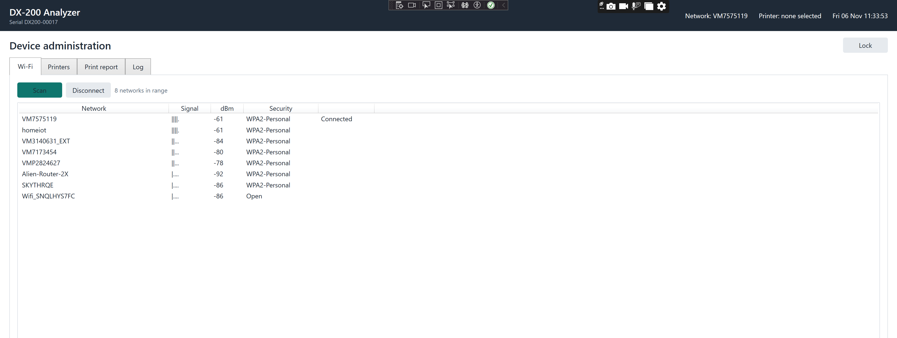
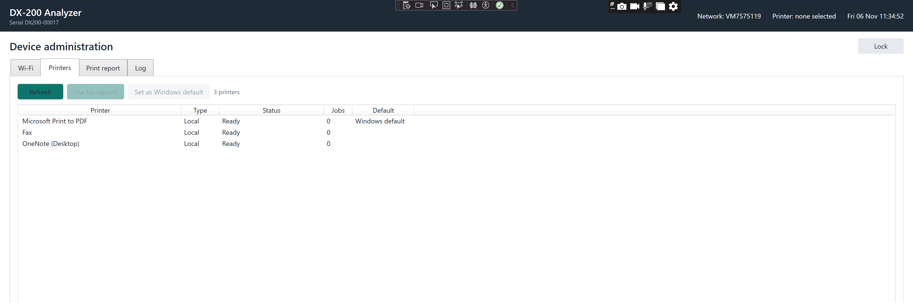

# Kiosk Admin Panel

A small WPF application that shows how device administration belongs inside a locked-down Windows appliance rather than on the desktop. It was written against a specific brief for a medical diagnostic instrument running Windows IoT Enterprise: Wi-Fi configuration, printer configuration and report printing from inside the C# application, with a kiosk lockdown around it and a documented way back in for servicing.

It is a demonstration, not a product. The diagnostic report is a sample with made-up values.

Video walkthrough, three minutes, running in kiosk mode: https://youtu.be/Ivnc72B56Ds

## What it does

| Area | What is implemented | Windows API used |
| --- | --- | --- |
| Admin gate | PIN entry with PBKDF2-SHA256 hashing, attempt counter, timed lockout | .NET cryptography |
| Wi-Fi | Enumerate adapters, scan, list SSIDs with signal and security type, connect with password, disconnect, surface wrong password / not in range / timeout, react to network status changes | `Windows.Devices.WiFi` and `Windows.Networking.Connectivity` (WinRT, called from WPF on .NET 8) |
| Printers | Enumerate local and network queues with live status (offline, paper out, door open, jobs queued), pick the report printer, set the Windows default, add a network printer by UNC path | `System.Printing` plus `winspool.drv` for `SetDefaultPrinter` and `AddPrinterConnection` |
| Printing | Build a diagnostic report as a `FixedDocument`, submit it to the chosen queue, track the job to completion or failure and report back in the UI | `System.Printing`, `System.Windows.Xps` |
| Logging | Rolling daily log in `ProgramData`, mirrored into a Log tab, unhandled exceptions caught and logged | |
| Kiosk mode | Borderless, topmost, maximised, close blocked while locked | WPF |
| Lockdown | Account split, Shell Launcher, Keyboard Filter, AppLocker (audit first), Windows Firewall default-deny inbound, verification script, recovery procedure | PowerShell in `lockdown/` |

## Layout

    src/KioskAdmin/            WPF app (.NET 8, net8.0-windows10.0.19041.0)
      Services/WinRtWifiService.cs
      Services/PrinterService.cs
      Services/ReportPrintService.cs
      Services/PinGate.cs
      Services/SettingsStore.cs
      Services/AppLog.cs
      Models/Models.cs
      MainWindow.xaml(.cs)
    tests/KioskAdmin.Tests/     xUnit tests for the pure logic (PIN, settings, printer status mapping, report)
    lockdown/                   PowerShell lockdown pack and RECOVERY.md
    docs/RECORDING.md           Shot list for the demo video

## Build and run

Requirements: Windows 10 1809 or later with a Wi-Fi adapter, .NET 8 SDK, Visual Studio 2022 17.8+ or `dotnet` CLI.

    dotnet build KioskAdmin.sln
    dotnet test KioskAdmin.sln
    dotnet run --project src\KioskAdmin

First run writes `C:\ProgramData\KioskAdmin\config.json` with a default PIN of `1234` and logs a warning. Change `DeviceName`, `SerialNumber` and the PIN before any deployment, and set `KioskMode` to `true` to get the borderless topmost window.

Tested on Windows 11 23H2 with an Intel Wi-Fi adapter, Microsoft Print to PDF and a network laser printer.

## Design notes

Wi-Fi goes through the WinRT `WiFiAdapter` API because it gives scan, connect and disconnect with typed results (`InvalidCredential`, `NetworkNotAvailable`, `Timeout`) and does not require shelling out to `netsh` or exposing any Windows UI. On a desktop app without package identity the call to `WiFiAdapter.RequestAccessAsync` is what grants access. If a particular Windows IoT image refuses it, the service sits behind `IWifiService`, and the fallback is the native WLAN API (`wlanapi.dll`: `WlanEnumInterfaces`, `WlanScan`, `WlanGetAvailableNetworkList`, `WlanConnect` with a profile XML) behind the same interface. Nothing in the UI changes.

Printing is deliberately split in two. Submitting the job has to happen on the UI thread because `XpsDocumentWriter` writes a WPF visual tree. Tracking the job happens on a background task that opens its own `PrintQueue`, polls `GetPrintJobInfoCollection`, and reports `IsInError`, `IsUserInterventionRequired`, `IsPaperOut` or completion back to the UI. That is the part a kiosk user actually needs: a printed page, or a clear reason there was not one.

The app's report printer is stored in the app config rather than relying on the Windows default printer. On a shared appliance the Windows default can drift (new driver installs, roaming profiles), and the report must always go to the printer the administrator chose.

AppLocker is applied in audit mode first. Switching to enforce before reading the audit log is how you brick a device's own update path.

## Lockdown order

1. `01-Create-Accounts.ps1` creates `kiosk` (standard user) and `svc-maint` (administrator). Auto logon for `kiosk` goes through Sysinternals Autologon so the password lives in an LSA secret.
2. `02-Configure-ShellLauncher.ps1` maps `kiosk` to the app with restart-on-exit, everyone else to Explorer.
3. `03-Configure-KeyboardFilter.ps1` blocks Win, Ctrl+Alt+Del, Alt+Tab, Alt+F4 and friends for non-administrators.
4. `04-Apply-AppLocker.ps1` applies `AppLocker-Policy.xml` in audit mode; `-Enforce` once the audit log is clean.
5. `05-Configure-Firewall.ps1` sets inbound default-deny on all profiles, disables discovery and remote-management rule groups, and turns off services the device does not need.
6. `06-Verify.ps1` prints a pass/fail table of the above and exits non-zero on any failure, so it can run from a build or servicing pipeline.

Shell Launcher and Keyboard Filter are Windows Enterprise and IoT Enterprise features; they are not available on Pro. `RECOVERY.md` covers getting a desktop back, updating the app, Safe Mode and full rollback.

## What is out of scope here

Unified Write Filter, BitLocker, an outbound firewall allow-list, Assigned Access (the UWP-style alternative to Shell Launcher) and MDM enrolment. Each is a short follow-up once the device's data and update story is agreed.

## Licence

MIT. See `LICENSE`.
